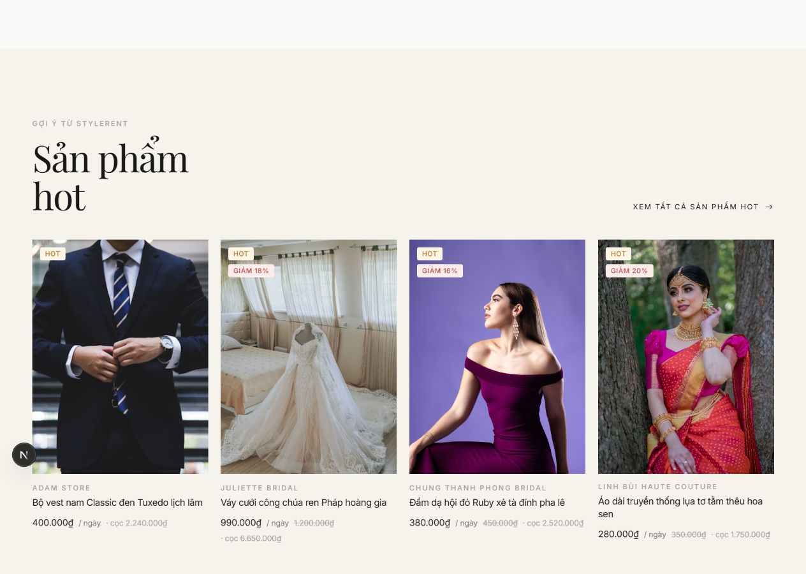
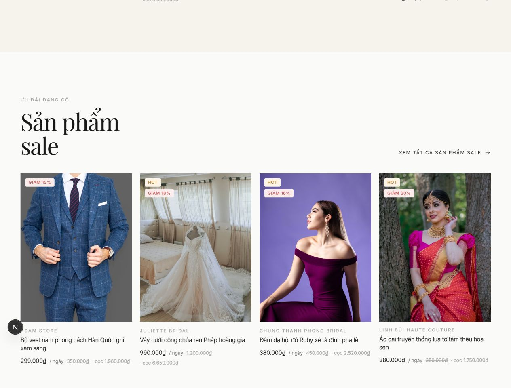
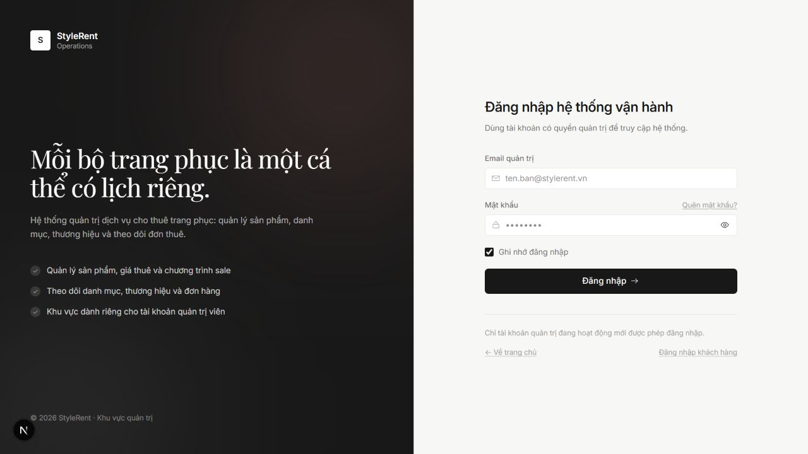

# Ghi nhận hoàn thiện trang chủ: sản phẩm hot, sale và danh mục thật

Ngày thực hiện: 18/10/2026.

Project được sửa: `D:\thltw_clone_18_10\THLTW-NHOM-HUY-TUYET-24E`, nhánh `levohongtuyet`.

Template tham khảo: `D:\template_thue_do\fashion-rental-web\frontend`.

## 1. Mục tiêu và cách hiểu chức năng

Hoàn thiện ba phần trên trang chủ theo hướng phù hợp đồ án môn học: dùng lại component giao diện đã có, gọi API Laravel và xử lý các tình huống cơ bản. Không bổ sung thư viện hay bảng dữ liệu mới.

- **Sản phẩm hot**: sản phẩm được đánh dấu nổi bật bằng `is_featured = true`. Đây là lựa chọn của người quản lý, không phải bảng xếp hạng số lượt thuê.
- **Sản phẩm sale**: đang bật `is_sale`, giá `sale_rental_price` lớn hơn 0 và nhỏ hơn `rental_price_per_day`.
- **Danh mục trang chủ**: tối đa 6 danh mục đang hoạt động và đang có sản phẩm hoạt động trực tiếp thuộc danh mục đó. Số lượng không cộng dồn sản phẩm của danh mục con.
- **Mới về**: giữ lại mục này, lấy 4 sản phẩm mới nhất theo `created_at`, sau đó theo `id` giảm dần nếu cùng thời điểm tạo.

## 2. Đối chiếu giao diện với template

Đã đọc và chạy template gốc để đối chiếu với project trên trình duyệt.

| Thành phần template | Áp dụng trong project |
| --- | --- |
| `app/page.tsx` | Giữ thứ tự các khối chính; giữ “Mới về”, thay “Đang được thuê nhiều” bằng “Sản phẩm hot”, thêm “Sản phẩm sale” phía dưới. |
| `components/home/Sections.tsx` | Giữ bố cục danh mục lệch cột `5 / 3 / 4`, hàng tiếp theo `4 / 4 / 4`; thay danh mục gán cứng bằng props từ API. |
| `components/product/ProductGrid.tsx` | Giữ hàng 4 sản phẩm trên desktop, cuộn ngang trên màn hình nhỏ. |
| `components/product/ProductCard.tsx` | Giữ ảnh tỉ lệ 3:4, font, nhãn, hover, tên thương hiệu, tên và giá; bổ sung nhãn giảm phần trăm và gạch giá cũ. |
| Nền, khoảng cách và chữ | Tái sử dụng `shell`, `bg-warm`, `SectionHead`, `Reveal`, `Chip` và các utility hiện có. |

Template gốc không có khối sale riêng trên trang chủ. Khối sale mới dùng cùng `SectionHead` và `ProductRail` để đồng bộ thiết kế, thay vì tạo một kiểu giao diện khác.

Ảnh sản phẩm/danh mục lấy từ dữ liệu backend nên nội dung ảnh khác template. Các ảnh có sẵn trong seeder là ảnh minh họa; nếu ảnh không khớp trang phục thực tế cần thay URL/ảnh trong dữ liệu sản phẩm.

## 3. Backend đã bổ sung

### Danh sách sản phẩm

File: `backend/app/Http/Controllers/ProductController.php`.

- Bổ sung lọc `is_featured` cho sản phẩm hot.
- Hoàn thiện lọc `is_sale=1`: bỏ sản phẩm không có giá giảm, giá giảm bằng 0, âm hoặc không thấp hơn giá gốc.
- Bổ sung lọc danh mục theo `category` là slug hoặc ID.
- Bổ sung `per_page`, nhận từ 1 đến 100; mặc định 12.
- Chỉ trả sản phẩm hoạt động, chưa xóa mềm và thuộc danh mục đang hoạt động, chưa xóa mềm.
- Tải thêm quan hệ ảnh và đầy đủ danh mục/thương hiệu để frontend có đúng ảnh, tên và slug.
- Sắp xếp mới nhất và thêm thứ tự theo ID để kết quả ổn định khi các bản ghi được seed cùng thời điểm.

### Danh sách danh mục

Files: `backend/app/Http/Controllers/CategoryController.php`, `backend/app/Http/Resources/CategoryResource.php`.

- Bổ sung `per_page` từ 1 đến 100; mặc định 12, thay giới hạn 2 mục cũ.
- Bổ sung `has_products=1` để chỉ lấy danh mục đang có sản phẩm hoạt động.
- Thêm `products_count`: đếm sản phẩm hoạt động, chưa xóa mềm.
- Thêm `preview_image`: ảnh thumbnail của sản phẩm hoạt động mới nhất trong danh mục.
- Không tạo migration, không chạy `migrate:fresh`, không sửa/xóa dữ liệu MySQL.

### Các API trang chủ sử dụng

| Mục | GET endpoint |
| --- | --- |
| Mới về | `/api/products?per_page=4` |
| Hot | `/api/products?is_featured=1&per_page=4` |
| Sale | `/api/products?is_sale=1&per_page=4` |
| Danh mục | `/api/categories?has_products=1&per_page=6` |
| Sản phẩm của danh mục | `/api/products?category=vay-du-tiec` |

Các endpoint giữ cấu trúc Laravel Resource gồm `data`, `links`, `meta`. Tham số lọc sai hoặc `per_page` ngoài khoảng cho phép trả HTTP 422.

## 4. Frontend đã sửa

### Trang chủ và service

- `frontend/src/services/homeService.js`: gọi API thật cho 4 mục trên; bỏ import `PRODUCTS`/`CATEGORIES` mẫu và bỏ cơ chế tự chuyển sang dữ liệu mẫu khi API lỗi/rỗng.
- `frontend/src/app/(user)/page.jsx`: gọi các API đồng thời bằng `Promise.allSettled`. Nếu một API lỗi, các mục còn lại vẫn hiển thị. Mỗi mục có thông báo riêng khi không có dữ liệu hoặc không tải được dữ liệu.
- Dùng `force-dynamic` để dữ liệu trang chủ được lấy lại khi tải trang, không bị đóng cứng tại lúc build.
- `frontend/src/components/user/HomeSections.jsx`: `CategoryStrip` nhận danh sách thật, hiển thị tên, mô tả, số sản phẩm và liên kết theo slug. Ưu tiên thumbnail sản phẩm qua `preview_image`, sau đó mới dùng `category.image`; cách này tránh dùng các đường dẫn ảnh danh mục trong seeder chưa có file tương ứng.

Luồng dữ liệu:

```text
Trang chủ → homeService → API Laravel → MySQL
                         ↓
           dữ liệu Resource → CategoryStrip / ProductRail → ProductCard
```

### Thẻ sản phẩm

File: `frontend/src/components/user/ProductCard.jsx`.

- Gắn nhãn Hot theo `is_featured`.
- Hiển thị giá sale, giá gốc gạch ngang và phần trăm giảm khi giá hợp lệ.
- Đọc ảnh đúng từ `images[].image_url`, rồi mới dùng thumbnail dự phòng.
- Tên và ảnh dẫn đến `/products/{slug}` thay vì query `selected` chưa được trang danh sách xử lý.
- Tiền cọc hiển thị theo `original_value × deposit_rate_percent / 100`; không còn tự lấy 2 lần giá thuê cho dữ liệu backend.
- Không gán mặc định 5 sao, 10 đánh giá khi API không cung cấp đánh giá.

### Trang đích của liên kết

Các chỉnh sửa nhỏ cần thiết để thao tác từ trang chủ hoạt động:

- `frontend/src/app/(user)/products/page.jsx`: nhận `is_featured=1`, `is_sale=1`, nhận đúng slug danh mục từ API, đổi tiêu đề theo nhóm đang xem, có thông báo lỗi/rỗng. Khi query URL đổi, khởi tạo lại bộ lọc tương ứng.
- `frontend/src/services/productService.js`: hàm đọc danh sách lấy các trang API, không tự thay bằng sản phẩm mẫu; tránh thiếu sản phẩm khi dữ liệu vượt trang đầu.
- `frontend/src/services/categoryService.js`: hàm đọc danh sách lấy đủ trang danh mục thật, không tự thay bằng danh mục mẫu.
- Các hàm ghi/xóa của admin trong những service này không nằm trong phạm vi thay đổi lần này.

## 5. Kiểm tra đã thực hiện

### Tự động

- Kiểm tra cú pháp PHP của 2 controller và resource danh mục: đạt.
- ESLint các file frontend thay đổi trong lần này: đạt.
- `npm run build`: build production thành công.
- `git diff --check`: không có lỗi whitespace.
- `vendor/bin/phpunit.bat --filter=HomepageApiTest`: **6 tests, 36 assertions, đạt**.

File kiểm thử: `backend/tests/Feature/HomepageApiTest.php`. Kiểm thử dùng SQLite `:memory:` từ cấu hình PHPUnit, không dùng database MySQL đang chạy.

Các tình huống được kiểm tra:

1. Hot loại sản phẩm thường, ẩn, xóa mềm và sản phẩm thuộc danh mục ẩn.
2. Sale chỉ nhận giá giảm hợp lệ; giá hiệu lực và phần trăm giảm đúng.
3. Danh mục có số lượng và ảnh từ sản phẩm thật, không tính sản phẩm ẩn/xóa mềm.
4. Lọc danh mục bằng slug và ID.
5. Thứ tự mới về và phân trang.
6. Database trống trả danh sách trống; bộ lọc sai trả 422.

### Chạy thực tế

- Trang chủ trả HTTP 200 và hiển thị hot, sale, danh mục từ backend.
- Dữ liệu local lúc kiểm tra: 8 sản phẩm hoạt động, 4 sản phẩm hot, 4 sản phẩm sale, 6 danh mục có sản phẩm.
- Nhấn “Xem tất cả sản phẩm sale”: hiển thị đúng 4 sản phẩm sale.
- Nhấn “Xem tất cả sản phẩm hot”: hiển thị đúng 4 sản phẩm nổi bật.
- Nhấn danh mục “Váy dự tiệc”: hiển thị đúng 2 sản phẩm thuộc danh mục.
- URL chi tiết sản phẩm từ thẻ mở được sản phẩm tương ứng.
- Đã so sánh trực tiếp giao diện project cổng 3000 và template cổng 3001 trên desktop.

Trình duyệt kiểm thử không áp dụng được lệnh đổi viewport sang 390px (kích thước thực vẫn là desktop), nên chưa xác nhận trực quan bằng viewport điện thoại. Các breakpoint và cơ chế cuộn ngang được giữ từ component template; cần kiểm tra thêm bằng Device Toolbar trên máy nếu yêu cầu chấm responsive chi tiết.

## 6. Cách chạy và kiểm tra lại

Backend:

```powershell
cd D:\thltw_clone_18_10\THLTW-NHOM-HUY-TUYET-24E\backend
php artisan serve
```

Frontend, ở terminal khác:

```powershell
cd D:\thltw_clone_18_10\THLTW-NHOM-HUY-TUYET-24E\frontend
npm run dev
```

Mở `http://localhost:3000`. Service mặc định gọi `http://localhost:8000/api`; có thể đặt `NEXT_PUBLIC_API_URL` trong cấu hình frontend nếu backend chạy ở địa chỉ khác.

Không cần chạy lại migration hay seed cho thay đổi lần này. Các trường `is_featured`, `is_sale`, `sale_rental_price` đã có trong model và request tạo/cập nhật sản phẩm.

Để một sản phẩm xuất hiện trong hot, đặt `is_featured=true`, trạng thái sản phẩm và danh mục là `active`. Để xuất hiện trong sale, bật `is_sale=true` và đặt giá sale lớn hơn 0, nhỏ hơn giá thuê gốc. Khi có hơn 4 sản phẩm đủ điều kiện, trang chủ chọn 4 sản phẩm mới nhất trong nhóm; liên kết xem tất cả hiển thị các sản phẩm còn lại.

## 7. Phạm vi và phần còn lại

- Các mục hot, sale, danh mục và mới về dùng API thật. API lỗi không được che bằng sản phẩm/danh mục mẫu.
- Các nội dung giới thiệu, banner Hero, đánh giá mẫu, lookbook và liên kết danh mục gán cứng ở thanh điều hướng vẫn thuộc giao diện cũ; chưa chuyển toàn bộ website sang API trong lần này.
- Trang chi tiết/giỏ thuê vẫn có logic demo riêng về đánh giá, gói thuê, biến thể và tiền cọc. Lần này chỉ xác nhận liên kết từ thẻ mở đúng sản phẩm, chưa hoàn thiện nghiệp vụ thuê ở những trang đó.
- Ảnh hiện có phụ thuộc URL bên ngoài trong dữ liệu seeder. Nếu ảnh bị gỡ/chặn từ nguồn ảnh, cần thay ảnh dữ liệu hoặc lưu ảnh vào storage của backend.
- Font local đã được sửa ở yêu cầu trước, giữ nguyên trong lần này.
- Chưa commit hoặc push thay đổi lần này lên GitHub.

Bản sao các file trước khi triển khai nằm tại `D:\thltw_12_10\co_Quyen_new\backup-homepage-20261018-211602`.

## 8. Ảnh kiểm tra giao diện






## 9. Bổ sung sửa đăng ký, đăng nhập

Nguyên nhân: form login/register chỉ có giao diện, nút type="button" không gửi request; AuthController có route register nhưng thiếu hàm xử lý. Validation điện thoại chỉ chấp nhận đúng 11 số.

Đã sửa:

- Thêm register trong AuthController, kiểm tra dữ liệu qua RegisterRequest, tạo tài khoản member/active, dùng cast hashed của model User để lưu mật khẩu đã mã hóa. Không nhận quyền admin từ dữ liệu form.
- Chấp nhận số điện thoại 10–11 chữ số; điện thoại/địa chỉ không bắt buộc. Mật khẩu từ 8 đến 256 ký tự, xác nhận phải khớp.
- Login và adminLogin xác thực bằng Auth::once rồi cấp Sanctum token, không phụ thuộc phiên web.
- Thêm authService, AuthProvider và AuthField; nối form đăng ký/đăng nhập với API thật. Có trạng thái đang gửi, lỗi từng trường và thông báo lỗi mạng/429.
- Đăng ký thành công hiện nút Đăng nhập ngay. Đăng nhập thành công lưu token trong localStorage và chuyển về trang chủ.
- API client gửi Authorization Bearer; tải lại trang kiểm tra token qua GET /api/user. Navbar hiện tên và nút đăng xuất. Đăng xuất thu hồi token qua API và xóa token trên trình duyệt; token đã hết hiệu lực cũng được xóa khi đăng xuất.
- Kiểm thử backend: AuthApiTest gồm 7 tests, 48 assertions đạt, dùng SQLite :memory:, không thay đổi MySQL.
- Lint các file xác thực đạt; build production đạt. Kiểm tra UI với dữ liệu đăng nhập sai và mật khẩu xác nhận không khớp đều hiển thị đúng phản hồi từ API, không tạo tài khoản kiểm thử trong MySQL.

Các file chính: backend/app/Http/Controllers/AuthController.php; backend/app/Http/Requests/User/{RegisterRequest,LoginInputRequest}.php; backend/tests/Feature/AuthApiTest.php; frontend/src/app/(user)/{login,register}/page.jsx; frontend/src/services/{api,authService}.js; frontend/src/store/auth.js; frontend/src/components/user/{AuthField,Navbar}.jsx; frontend/src/components/layout/Providers.jsx.

Không cần migration hoặc seed lại. Sau khi tải lại trang, có thể đăng ký tài khoản mới rồi dùng email/mật khẩu vừa tạo để đăng nhập. Chưa commit/push.

## 10. Hoàn thiện đăng nhập admin theo template

Đường dẫn: /admin/login. Đã đối chiếu trực tiếp với template tại D:\template_thue_do\fashion-rental-web\frontend-admin\app\login\page.tsx.

Giao diện giữ bố cục hai cột, nền tối và hiệu ứng sáng nhẹ bên thương hiệu, form bên phải, icon email/khóa/mắt, nút hiện/ẩn mật khẩu và quên mật khẩu. CSS form được đặt riêng trong admin-login.css để input, nhãn và nút gần template mà không ảnh hưởng trang khách hàng. Nội dung giới thiệu được điều chỉnh theo chức năng của project. Không dùng danh sách tài khoản/role giả và hàm authenticate demo của template.

Luồng code đơn giản:

1. Form ở frontend/src/app/admin/login/page.jsx lấy email và mật khẩu, gọi adminAuthService.login.
2. Service gửi POST /api/admin/login. Backend kiểm tra email, mật khẩu, role=admin và status=active, rồi cấp token Sanctum.
3. adminToken.js lưu token admin riêng. Chọn Ghi nhớ đăng nhập thì dùng localStorage; bỏ chọn thì dùng sessionStorage của tab. Không gán thời hạn 30 ngày như nội dung demo trong template.
4. frontend/src/app/admin/layout.jsx gọi GET /api/admin/me để kiểm tra quyền trước khi hiện sidebar/header/nội dung. Nếu chưa có token, token sai hoặc không đủ quyền thì chuyển về /admin/login. Nếu máy chủ không kết nối được, hiển thị lỗi và nút Thử lại.
5. api.js chọn token admin cho các request /admin/*; request khách hàng tiếp tục dùng token khách hàng.
6. AdminHeader hiển thị tên thật từ API. Nút Đăng xuất gọi POST /api/admin/logout, thu hồi token, xóa lưu trữ và trở về form login.

Backend: tất cả API trong nhóm /api/admin/* được đặt dưới auth:sanctum và CheckAdmin, ngoại trừ POST /api/admin/login. CheckAdmin kiểm tra cả role admin và trạng thái active. Thành viên có token cũng không được gọi API quản trị. API công khai của trang chủ/sản phẩm không đổi quyền truy cập.

Các file chính: frontend/src/app/admin/login/page.jsx; frontend/src/app/admin/login/admin-login.css; frontend/src/app/admin/layout.jsx; frontend/src/components/admin/AdminHeader.jsx; frontend/src/services/{api,adminToken,adminAuthService}.js; frontend/src/components/ui/Icons.jsx; backend/routes/api.php; backend/app/Http/Middleware/CheckAdmin.php; backend/app/Http/Controllers/AuthController.php.

Kiểm tra:

- 13 tests, 87 assertions của AdminAuthApiTest và AuthApiTest đều đạt trên SQLite :memory:.
- Bao gồm admin đăng nhập/đăng xuất, đọc profile, khách bị 401, thành viên bị 403 ở các nhóm tài nguyên admin, admin khóa/xóa mềm bị chặn và dữ liệu login thiếu bị 422.
- Lint và build production đạt, git diff --check không có lỗi whitespace.
- Browser: mở /admin khi chưa login tự về /admin/login; tài khoản admin mẫu có sẵn đăng nhập thành công; reload vẫn giữ phiên; logout về form; tài khoản member mẫu bị từ chối; hiện/ẩn mật khẩu hoạt động.
- Thử trực tiếp server: khách gọi /api/admin/me nhận 401, API sản phẩm công khai vẫn trả 200.
- Đã kiểm tra trực quan ở desktop và giữ breakpoint hai cột/ẩn cột thương hiệu trên màn hình nhỏ từ template. Chưa xác nhận trực quan viewport mobile do giới hạn trình duyệt kiểm thử nêu ở mục 5.

Để thử trên dữ liệu seed hiện có: admin@gmail.com / admin123456. Đây là thông tin có sẵn trong UserSeeder của project; không tạo thêm tài khoản, không đổi mật khẩu và không chạy lại database khi triển khai.

Nút Quên mật khẩu chỉ hướng dẫn liên hệ người quản lý, giống cách xử lý trong template; chưa thêm luồng gửi email đặt lại mật khẩu. Chức năng CRUD/dashboard hiện có không được viết lại trong lần này. Chưa commit/push.

Bản sao file trước khi sửa: D:\thltw_12_10\co_Quyen_new\backup-admin-login-20261018-220521.



## 11. Sửa kết nối database theo phpMyAdmin của người dùng

Đã xác minh cấu hình thực tế trước khi sửa là SQLite, file backend/database/database.sqlite, do backend chưa có .env. Tài khoản đăng ký có được lưu, nhưng không nằm trong MySQL mà người dùng đang xem. Các mô tả MySQL ở phần kiểm tra runtime trước thời điểm này chưa chính xác; chúng không phải bằng chứng rằng API trước đó đã dùng MySQL.

Sau khi người dùng cung cấp ảnh phpMyAdmin cho biết database đích là thltweb_huy_tuyet:

- Tạo backend/.env, đặt APP_ENV=local, tạo APP_KEY và cấu hình DB_CONNECTION=mysql, DB_DATABASE=thltweb_huy_tuyet trên MySQL local. File .env được Git bỏ qua.
- Sao lưu nguyên SQLite và bảng users MySQL trước khi thay đổi, tại D:\thltw_12_10\co_Quyen_new\backup-database-switch-20261018-172107.
- Chỉ bổ sung tài khoản thành viên đang hoạt động/chưa xóa còn thiếu theo email, giữ nguyên hash mật khẩu và thông tin, không ghi đè tài khoản đã có. Không chuyển token đăng nhập cũ.
- Đã chuyển tuyet@gmail.com (ID 4) và huy@gmail.com (ID 5). Bảng users MySQL hiện có 5 tài khoản. Không migrate:fresh, không seed, không xóa các bảng.
- Chạy php artisan config:clear.
- Xác minh API HTTP đang chạy: đăng nhập admin trả 200, token mới xuất hiện trong personal_access_tokens của MySQL; đọc profile và đăng xuất đều trả 200.
- Thử route đăng ký bằng transaction trên MySQL: HTTP 201 và có INSERT vào users. Đã rollback tài khoản kiểm thử, không để lại tài khoản thử trong bảng.

Từ thời điểm này các đăng ký mới được backend lưu vào bảng users của MySQL thltweb_huy_tuyet. Người dùng tải lại phpMyAdmin để xem dữ liệu. Những tài khoản đã đăng nhập bằng token SQLite có thể cần đăng nhập lại.
